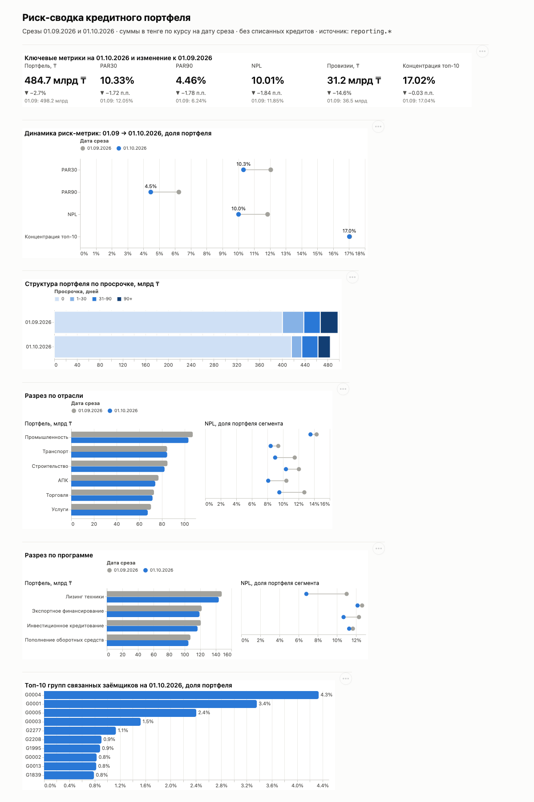

# Риск-сводка кредитного портфеля

PostgreSQL 16 → вьюхи `reporting.*` → семантическая модель (YAML) → дашборд на Vega-Lite.
Синтетический портфель, срезы на **01.09.2026** и **01.10.2026**.



## Как запустить

Нужны Docker и Python 3.9+. Сторонние Python-пакеты не нужны.

```bash
./scripts/run.sh                         # поднимает postgres:16, грузит raw, создаёт вьюхи, выгружает dashboard/data/*.json
python3 -m unittest -v tests/test_metrics.py   # независимая сверка цифр
python3 -m http.server 8765 -d dashboard # дашборд: http://localhost:8765
```

`run.sh` можно запускать повторно: таблицы `raw` создаются через `IF NOT EXISTS` и перезаливаются через `TRUNCATE` + `COPY`, а вьюхи создаются через `CREATE OR REPLACE VIEW`. Postgres слушает порт `5433`, логин и пароль `postgres/postgres`, база `risk`.

## Структура

| Путь | Что внутри |
|---|---|
| `sql/01_raw.sql` | схема `raw`: таблицы `portfolio`, `fx`, загрузка CSV |
| `sql/02_reporting.sql` | схема `reporting`: витрина `v_loan_snapshot`, `v_group_exposure`, `v_metrics`, `v_metrics_change` (изменение к 01.09), `v_breakdown` (отрасль/программа), `v_data_quality` |
| `model/credit_portfolio.yml` | семантическая модель поверх `reporting.v_loan_snapshot` |
| `dashboard/specs/*.json` | спеки Vega-Lite (генерируются `scripts/build_specs.py`) |
| `dashboard/index.html` | статичная страница, рисует спеки через vega-embed |
| `dashboard/data/*.json` | выгрузка вьюх для дашборда (делает `run.sh`) |
| `tests/test_metrics.py` | сверка с независимым расчётом на Python |

## Очистка данных

| Что | Как обработано |
|---|---|
| 30 полных дублей строк на каждую дату (2030 строк на 2000 кредитов) | `SELECT DISTINCT` |
| Списанные (`written_off = 1`): 25 кредитов на 01.09, 8 на 01.10 | исключены по флагу на дату среза |
| USD-кредиты | пересчёт по курсу **на дату среза** (01.09 — 478.35, 01.10 — 482.10). Курс на 31.08 другой (473.47), поэтому «последний доступный» курс здесь неверен |
| Нет курса на дату | `LEFT JOIN`, пропуски видны в `v_data_quality.missing_fx_rows` (сейчас 0) |
| Провизии | приоритет у NPL: реструктуризированный кредит без просрочки получает 50%, а не 1% |

## Итоговые цифры

| Метрика | 01.09.2026 | 01.10.2026 | Изменение |
|---|---:|---:|---:|
| Портфель, млрд ₸ | 498.15 | 484.67 | −13.48 (−2.7%) |
| Кредитов в портфеле | 1 975 | 1 992 | +17 |
| PAR30 | 12.05% | 10.33% | −1.72 п.п. |
| PAR90 | 6.24% | 4.46% | −1.78 п.п. |
| NPL | 11.85% | 10.01% | −1.84 п.п. |
| Провизии, млрд ₸ | 36.51 | 31.17 | −5.34 (−14.6%) |
| Провизии / портфель | 7.33% | 6.43% | −0.90 п.п. |
| Концентрация топ-10 групп | 17.04% | 17.02% | −0.03 п.п. |

## Три вывода для риск-комитета

1. **Улучшение PAR90 и NPL по большей части техническое.** 53 кредита с просрочкой 90+ на 01.09 к 01.10 показывают ноль дней просрочки: за месяц так вылечиться почти невозможно без реструктуризации или пересмотра графика. Ещё 23 кредита, помеченные на 01.09 как **списанные**, на 01.10 снова в портфеле (5.7 млрд ₸, из них 3.0 млрд ₸ — 90+). Прежде чем фиксировать снижение NPL на 1.8 п.п. и высвобождение провизий на 5.3 млрд ₸, нужно запросить у бизнеса основания для «излечения» и восстановления списанных кредитов.
2. **Промышленность ухудшается против общего тренда.** PAR30 в отрасли вырос с 8.5% до **16.5%**, хотя во всех остальных отраслях он снизился, а NPL отрасли самый высокий — 13.5%. По портфелю в целом 28 кредитов перешли из корзины 31–90 в 90+. Это ранний сигнал роста NPL в Промышленности уже в следующем месяце: стоит поставить отрасль на мониторинг и проверить крупнейших заёмщиков.
3. **Концентрация стабильна, но высока на верхушке.** На топ-10 групп приходится 17% портфеля, на топ-3 — 10%. Одна группа G0004 занимает 4.3%, это на 0.9 п.п. больше следующей. Отдельно: 438 кредитов (98 млрд ₸, ~20% портфеля) числятся с остатком после даты погашения. Это либо пролонгации без обновления `maturity_date`, либо скрытая просрочка, и нужна сверка с источником.

## Как проверялись цифры

- `tests/test_metrics.py` с нуля пересчитывает все метрики из CSV на чистом Python (`Decimal`, без SQL) по определениям из задания и сверяет с `reporting.v_metrics`, `v_metrics_change` и `v_breakdown` с допуском 1e-9.
- Инварианты: PAR90 ≤ PAR30, PAR90 ≤ NPL, сумма разрезов по отрасли и программе равна портфелю, витрина уникальна по (дата, кредит), нет пропущенных курсов.
- Отдельный тест проверяет, что USD берётся по курсу на дату среза (478.35 и 482.10).
- Все `column` из YAML-модели существуют во вьюхе-источнике, а доли, посчитанные через меры модели (`par30_kzt / portfolio_kzt`), совпадают с эталоном.
- Идемпотентность: тест повторно прогоняет оба SQL-скрипта и проверяет, что метрики и число строк в `raw` не изменились.
- Дашборд проверен глазами по скриншоту: KPI-плитки совпадают с таблицей выше.

## Семантическая модель

Формат: `model`, `source`, `dimensions` (name, column, type, label), `measures` (name, column, type: sum/avg/count, format, label).
Типы мер ограничены `sum/avg/count`, поэтому доли выражены через суммовые колонки витрины (`par30_kzt`, `par90_kzt`, `npl_kzt`): доля = `sum(x_kzt) / sum(principal_kzt)` в любом разрезе. `avg` по флагу не подходит: он дал бы долю **по количеству** кредитов, а не по сумме.

## Работа с ИИ

Проект сделан с Claude Code. Контекст для агента — [CLAUDE.md](CLAUDE.md), заметка об ошибках — [docs/ai-notes.md](docs/ai-notes.md).
